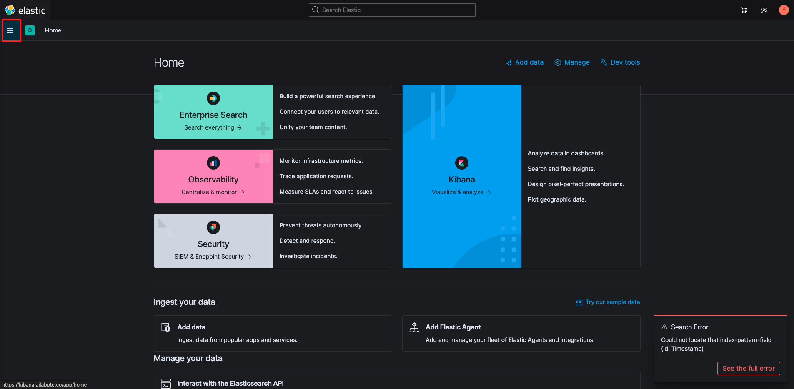
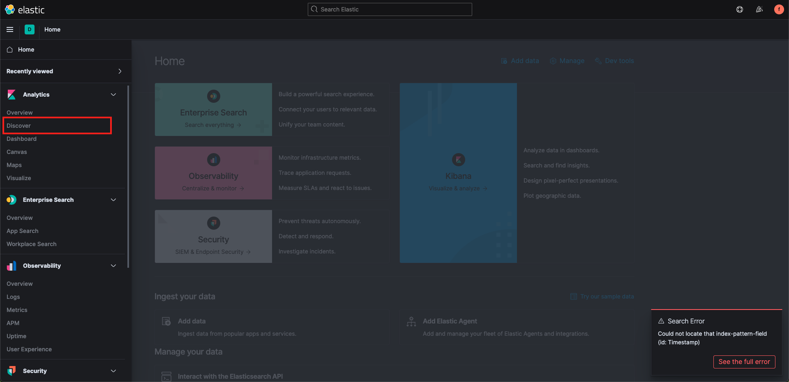
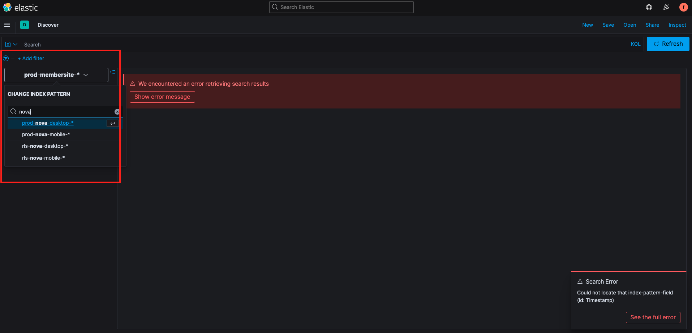
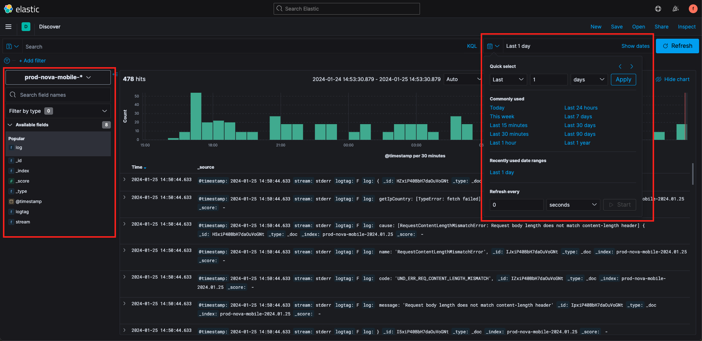

# Elastic Log

### 功能：

因 NX-NEXT 上線後，會有部分 log 僅會顯示在 server side ，而無法從 chrome devtool 查看。

故某些時候需透過後端提供的 EKS 介面進行前端程式的 error log 查找。

---

[ELK網址](https://kibana.ailabpte.co/)

公用帳號已關閉，有需要使用者再洽主管索取個人帳號。

---

### 使用方式 

1. 登入介面後點擊左側 Menu 找到 Discover 功能 

    

    

2. 進入 Discover 頁面後透過左上角做專案的搜尋 : nova , reward 等...  ( 前端僅能看到自己專案的 Log )
    
    

3. 進入頁面後點擊左側 Log 並於右上角指定區間便可看到當前 Server Log 內容。

    