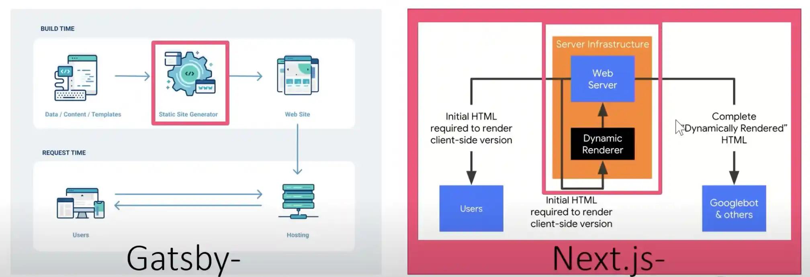
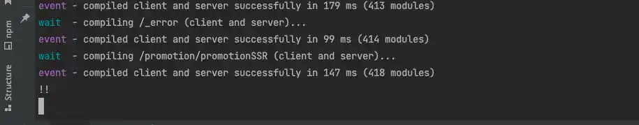
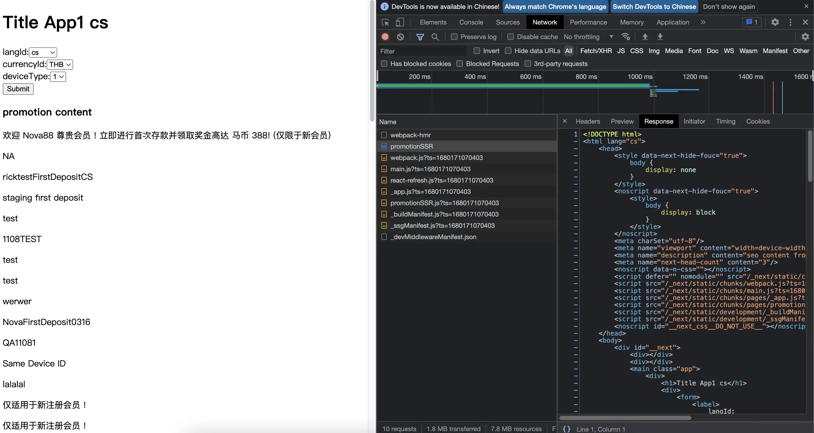

# Next 基本開發心法

## 前言

在初次使用 `NextJS` 框架時，`NextJS` 與 `GatsbyJS` 有一個關鍵差異，`GatsbyJS` 僅提供靜態網站的輸出，可以理解成 `NextJS` 的 SSG。

> SSG、SSR 若不理解可先看[這篇](https://wenchen1997.com/blog/nextjs/nextJs-pre-rendering)



基本上可以將 NextJS 在過去視為專注於 SSR 的 FrameWork , 而 GatsbyJS 則是專注於 SSG 的 FrameWork 

而在 2021 之後，兩家框架不約而同都開始提供 SSR 與 SSG，但本質上仍遵循他們過去的出發點。

雖說目前新版本的 Gatsby 也可以支援 SSR，但我們暫時不討論這塊，因我們過去 Gatsby 專案沒有用到 SSR，所以我們都先將 Gatsby 視為 SSG 框架

而 NextJS 則是以目前使用的版本 `Next 12` 的環境做說明。

--- 
## ServerSide Rendering

GatsbyJS 在預設情況下 GatsbyJS 會在 build time 把所有網頁佈一份靜態頁出來，所以在架構邏輯上跟原生 React 差異不會太大。

NextJS 在撰寫時若要使用 SSR 或 SSG 必須遵循他們的 data Fetching 規則 (`getServerSideProps`、`getStaticProps`) 來獲取資料，並將資料作為 props 傳遞至元件中。

若沒透過上述方式的話，在元件中進行 `fetching` 一律都會是 CSR，這點要特別注意。

然而因為 ServerSideRendering 的存在，我們在開發時就不能像過去開發 React 的方式一樣，單純就瀏覽器 devTool 來開發，因為 serverSide 的資料，是不會出現在瀏覽器的。


```ts
export const getServerSideProps: GetServerSideProps = async context => {
	console.log('!!')
	//...

	return {
		props: {
		//	...
		},
	}
}
```

上面的程式碼可以看到，我們在 `getServerSideProps` 內去 `console.log("!!")`，根據我們過去習慣，假如我們這時候去瀏覽器開 F12 查看，肯定是看不到任何東西的。

**KeyPoint** : 
> 不管是Local 還是 PRD ，我們運行程式的 terminal 便是我們的 ServerSide

所以我們可以回到編輯器的 terminal 看到：



和 React 不同的是，React 在 `run dev` 時，會起一個 node server 供我們做熱開發，即時更新我們在程式碼中做的改動。

NextJS 在 `run dev` 時 node server 不僅僅是用來熱開發，同時還會負責 ServerSideRender 的 Server。

--- 
## Data Flow & Hydration
前文提到，在 SSR 中，SSR 會透過運行 `getServerSideProps` 來將整個頁面渲染成 HTML 後傳入用戶端：



**Key Word** : 

這裡先提下 NextJS 中很重要的一個名詞 **hydration**，在 SSR 時，因為 server 傳遞給瀏覽器的是一個完整的靜態 HTML 頁面，HTML 本身是不能互動的，
所以在瀏覽器端在接收到 HTML 後會進行 **hydration**，將 JS 與 dom 節點綁定，後續由 CSR 接管頁面。


從資料面來看的話，我們可以將 SSR 視為 **首次 Fetching Data**，後續的 `data fetching` 則由 Client Side 來接管。

運用 `hydration` 的概念，我們在專案設計上，因為 client side 使用 RTK Query 來做 data fetching，所以某些在首次 landing 後仍需從 client site 打 api 獲取資料的頁面，我們可以這樣寫：

```ts
// * lazy query example
const [
    getPromotionListV3Query,
    { data: { data: promotionList = initialPromotionList } = {}, isLoading },
] = useLazyGetPromotionListV3Query()
```

在上面範例中，我們運用 RTK query hooks 的特性，在 data 給予預設值，而該預設值便是我們透過 SSR 取得的 props。

這樣我們可以輕易的在取得 SSR data props 後，由 CSR 去接管後續頁面的資料異動。

> 假如不需要在 Client side 另外撈取 api 的話，則直接使用 SSR 傳遞的 props 即可。


## Data Fetching & Life Cycle 

關於目前專案的 Data Fetching 方式，因為 react hooks 不能在 react component 以外的地方使用。

而不管是 `getServerSideProsp` 或 `getStaticProps`，他們都不屬於 React component，正確來說他們是在建構頁面時，在 serverSide 調用的 function。

所以在目前的專案架構中，我們透過 `axios` 處理 serverSide api Fetching，而到了 Client Side 後再由 RTK query 處理 CSR 的 api Fetching。

至於生命週期部分，SSR 頁面不管是 `getServerSidePorps` 還是 `getStaticProps`，都是在頁面渲染之前執行，可以將其視為在過去我們熟知的 `componentDidMount` 之前。


## CSR 限定 

有些時候我們需要在 React 元件之中調用一些僅存在於 client side 的 value ，像是：`window` , `localStorage`

我們可以有幾種方式：

```ts
if(window !== undefined){
    // ... method in client side   
}


useEffect(() => {
    // ...method in client side
} , [])
```

透過判斷 `window` 是否存在，或透過 `useEffect` 在頁面加載完成後才執行，都可以確保該程式碼只有在 Client side 才會被執行。

> 若使用 `usehooks-ts` import hooks 出來使用時，套件本身原始碼已經有寫入判斷了，會確保程式只會在 client side 被調用

