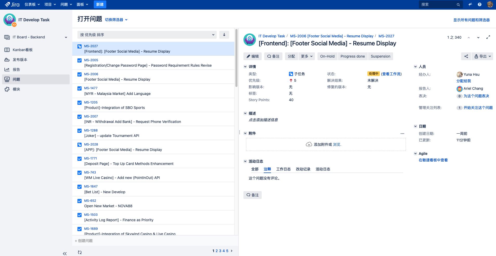
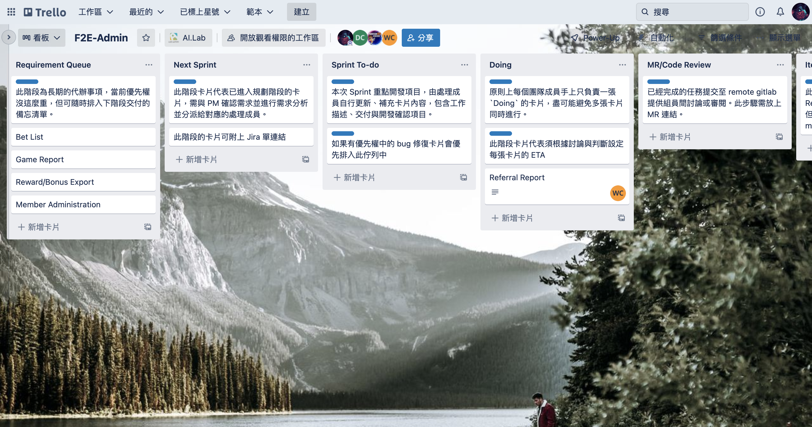

# Team Task Process

當前團隊的工作項目以 (Jira) 為核心作為需求主單，搭配 (Trello) 進行任務規劃與進度呈現

## Jira

需求細節整合在 Jira 單上

## 團隊看板

看板上的渠道可分為以下幾個

- Requirement Queue

  此階段為長期的代辦事項，當前優先權沒這麼重，但可隨時排入下階段交付的備忘清單。

- Next Sprint
  此階段卡片代表已進入規劃階段的卡片，需與 PM 確認需求並進行需求分析並分派給對應的處理成員。

- Sprint To-Do
  本次 Sprint 重點開發項目，由處理成員自行更新、補充卡片內容，包含工作描述、交付與開發確認項目。

  如果有優先權中的 bug 修復卡片要優先排入此佇列中

- Doing
  此階段卡片代表須根據討論與判斷設定每張卡片的 ETA ( Estimated Time of Arrival ) 並更新卡片上的標題、描述與工作確認項目，一張卡片最好僅由一個成員獨立完成與處理，過程中如有協助需求也可轉交由其他人處理。

  每張卡片的 ETA 與最長週期盡量不要超過一個工作週（五天）。

  正常情況下，每個團隊成員手上只負責一張 `Doing` 的卡片，盡可能避免多張卡片同時進行。

- MR/Code Review
  已經完成的任務提交至 remote gitlab 提供組員間討論或審閱。

  正常開發來說此步驟需放上 MR 連結。

- Iteration Done
  此階段卡片代表已經通過 `MR/Code Review` 階段，並保存在 `Gitlab` 上，但尚未合併進相關主分之中 ( master/develop )。

- Sprint Delivery
  此階段卡片代表已完成上述過程，並透過 Jenkins 的 **Build** 與 **Deploy** 流程發布至 Stage 環境中
